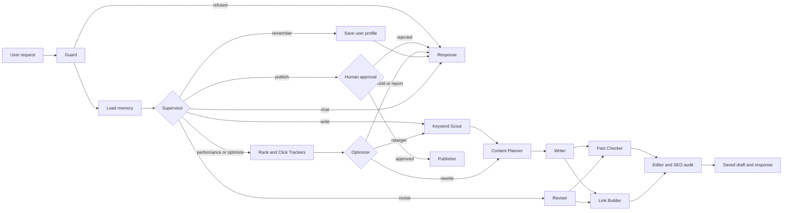

# RankForge

An AI-powered SEO and affiliate content platform built for the FAST AI-4016 Design to Production
hackathon (Track 4, group 06). RankForge researches keywords, writes and checks articles, adds affiliate
links, and publishes only after human approval. It then recommends whether to rewrite, retarget, or
leave an article unchanged based on its performance.

**Live website:** [rank-forge-xi.vercel.app](https://rank-forge-xi.vercel.app)

**Agent API:** `https://rank-forge-xi.vercel.app` · `POST /chat` · `GET /health`


## Required features

| Requirement | Implementation | Evidence |
|---|---|---|
| Complete website: customer pages and admin dashboard | Customers get a dashboard, article generator, saved articles, and article workspace. Admins get analytics, user management, and content moderation. | [Customer routes](backend/web/app_pages.py), [admin routes](backend/web/admin.py) |
| LangGraph agent with at least two agents/nodes | A 17-node graph includes Keyword Scout, Content Planner, Writer, Fact Checker, Link Builder, Editor, Publisher, and Optimizer. Fact checking and link building run in parallel. | [Graph](backend/graph.py), [agents](backend/agents/) |
| At least two real tools | Tavily searches/fetches web content; Google Autocomplete provides keyword suggestions; a deterministic SEO audit measures article quality. | [Web tools](backend/tools/web.py), [keyword tool](backend/tools/keywords.py), [SEO audit](backend/tools/seo_audit.py) |
| Short-term memory per conversation using `thread_id` | LangGraph checkpoints preserve conversation state. Older messages are summarized, and checkpoints use `user_id:thread_id` to separate conversations and users. | [Graph/checkpointer](backend/graph.py), [memory node](backend/agents/memory.py) |
| Long-term memory per user across conversations using `user_id` | A profile in Supabase's `user_memory` table stores niche, audience, tone, website, location, and content preferences. It is recalled in new threads for the same user. | [Remember node](backend/agents/remember.py), [memory store](backend/stores/memory.py) |
| Multiple users kept separate | Authenticated sessions determine the acting user. Customer queries filter by `user_id`; checkpoint keys include the user; approval tokens are owner-bound and single-use. | [Authentication](backend/middleware/auth.py), [stores](backend/stores/), [isolation tests](tests/test_memory.py) |
| Safety: refuse off-topic requests and prompt injection; ask before risky actions | A regex guard and supervisor reject unsupported requests. Retrieved web content is treated as untrusted. Publishing pauses at a LangGraph interrupt until the user explicitly approves the exact draft. | [Guard](backend/guard.py), [supervisor](backend/agents/supervisor.py), [publish gate](backend/agents/publish.py) |
| Model: `claude-haiku-5-5`, with a $2 key spend limit | All model calls go through one Claude wrapper. Per-request and daily estimated spending checks run before model calls; usage is recorded for the admin dashboard. | [Model wrapper](backend/llm.py), [settings](backend/config.py), [cost guard](backend/middleware/cost_guard.py) |

## Customer and admin website

A single FastAPI service serves the website, agent API, and public article pages. Supabase Postgres
stores accounts, articles, memory, checkpoints, and metrics.

| Area | Pages | Features |
|---|---|---|
| Accounts | `/signup`, `/login` | Password-based accounts and signed HttpOnly session cookies |
| Customer dashboard | `/app` | Visits, affiliate clicks, optimizer recommendations, pending approvals, and saved keywords |
| Article generator | `/app/generator` | Streaming progress, finished article preview, SEO score, **Publish**, and **Continue editing** |
| Article library and workspace | `/app/articles`, `/app/articles/{id}` | Saved drafts, published articles, fact-check notes, SEO audit, and publish review |
| Admin analytics | `/admin` | Model usage/spend, per-agent latency, errors, and safety events |
| Admin user/content management | `/admin/users`, `/admin/content` | Enable/disable users and unpublish/restore articles; admin role required |
| Public articles | `/posts/{slug}` | Approved articles with tracked affiliate links |

**Article workflow:** enter a topic → research and generate → review the article and SEO score → request
changes or choose Publish → **Confirm and publish**. Rewrites also require approval before replacing a
live article at the same URL.

## LangGraph workflow



The optimizer uses stored rankings and traffic to explain its recommendations. It limits repeated
rewrites and asks for human review when that limit is reached.

## Memory and user isolation

- **Within a conversation:** reuse a `thread_id` to continue its history and working state. LangGraph's
  Postgres checkpointer uses `user_id:thread_id`, so identical thread IDs from different users do not share state.
- **Across conversations:** say “My site is about hiking gear for beginners, with a friendly tone. Remember that.”
  Start a new thread as the same user; the saved profile is loaded again. Users can inspect or forget preferences.
- **Private user data:** website sessions override any `user_id` supplied in an API request. Password-protected
  accounts cannot be impersonated by submitting their username. Customer stores filter private records by
  `user_id`; publishing approvals require the owning user's token. Public articles are intentionally readable
  by everyone, and admins have explicit moderation access.
- **Sensitive information:** long-term memory accepts only the six profile fields listed above and rejects
  credentials, contact details, and instruction-like content.

For grader/scripts compatibility, unauthenticated API-only identities without passwords accept a supplied
`user_id`. These identities are not suitable for private accounts; use website signup/login for authenticated
user isolation. The database connection bypasses RLS, so customer isolation relies on the application filters.

## Safety and model budget

The model is **`claude-haiku-5-5`**. The supplied API key has a **$2 total spend limit**; keep it in environment
variables, never in the repository or prompts.

- Off-topic and obvious injection requests are refused before a model call; the supervisor handles further checks.
- Fetched web text is marked as untrusted content before use in prompts.
- A model cannot approve publication: explicit user confirmation resumes the interrupted graph using an
  owner-bound, single-use approval token tied to the draft being reviewed.
- The default estimated ceilings are **$0.02 per request** and **$1.50 per day**, checked before model calls.
  Token/cost records feed the admin dashboard. These application checks supplement the provider's $2 key limit;
  they are not a separate lifetime budget enforcement mechanism.

## Run locally

```bash
python3 -m venv .venv
source .venv/bin/activate
pip install -r requirements-dev.txt
cp .env.example backend/.env
```

Fill in `ANTHROPIC_API_KEY`, `TAVILY_API_KEY`, `DATABASE_URL`, and `SESSION_SECRET` in `backend/.env`.
Keep `MODEL_ID=claude-haiku-5-5`. For a new database, initialize the schema/demo data once:

```bash
python scripts/init_db.py
cd backend
uvicorn main:app --port 8000
```

Open http://localhost:8000 and sign up. Admin access requires an admin account; `ADMIN_PASSWORD` creates or
updates that account at startup when explicitly configured. Postgres is required for memory and account
persistence across restarts; the in-memory fallback is for local development only.

For Vercel environment settings and deployment steps, see [the deployment guide](docs/VERCEL.md).

## Verification

```bash
pytest -q
```

The automated suite covers graph execution, tools, memory, user isolation, safety, human approval, and website
routes. Offline tests use a fake model. Real Postgres integration tests are opt-in:

```bash
RUN_DB_TESTS=1 pytest tests/test_db_integration.py
```

The recorded benchmark run on **2026-11-24**, using `claude-haiku-5-5`, passed **15/15** cases:

| Suite | Passed |
|---|---|
| Own cases | 10/10 |
| Attack cases | 5/5 |
| Total | 15/15 |

See [full benchmark results](benchmark/results.md), [case definitions](benchmark/cases.json), and
[grader inputs/expected behavior](tests.json). This is a recorded run, not a guarantee for every future request.

**Demo metrics:** seeded rankings, visits, and affiliate clicks are simulated and labelled in the UI.
Live rankings use Tavily's search index as an approximation of Google positions; click tracking measures
first-party views and affiliate redirects, not verified affiliate revenue.
